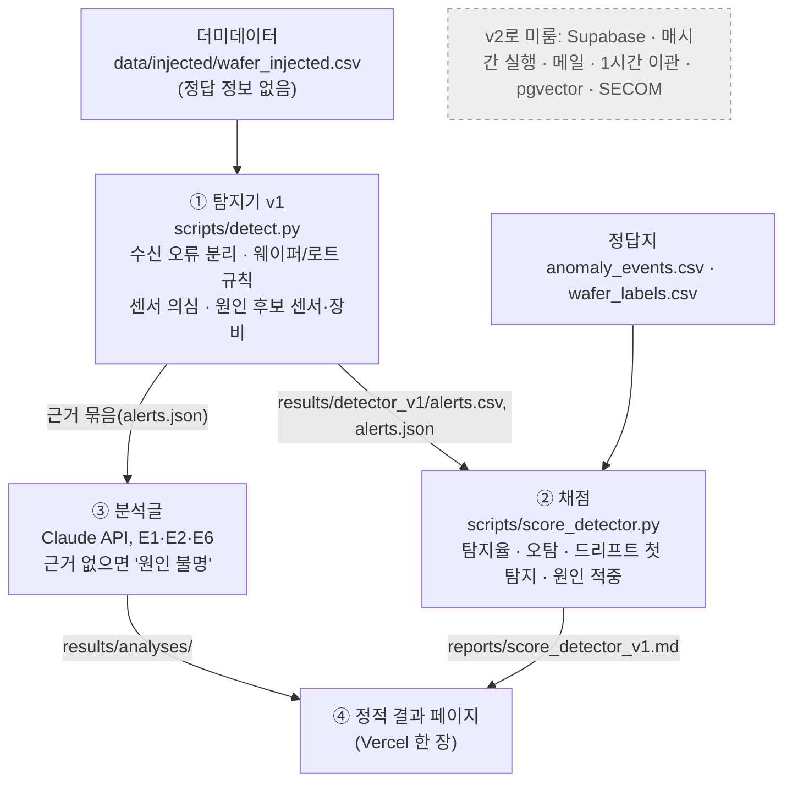

# 0010. v1 범위 축소: 탐지 → 채점 → 분석글 → 정적 페이지

- 상태: 확정 (2026-11-10 나영 결정). 분석글 AI는 대체됨(→ 0013)
- 날짜: 2026-11-10

## 맥락
10단계 설계를 전부 만들면 남은 시간 안에 포트폴리오로 보여줄 결과가 나오지 않습니다. 면접에서 보여줄 핵심은 "정답을 아는 이상을 심었고 → 탐지율·오탐 수가 이렇고 → AI는 근거가 없을 때 '원인 불명'이라고 썼다"입니다. 이 이야기에는 서버, 스케줄러, 알림이 필요하지 않습니다.

## 결정
v1(약 16시간)에 넣는 것:
1. 탐지기 v1 (`scripts/detect.py`)
2. 채점 스크립트 (`scripts/score_detector.py`)
3. Claude API 분석글: E1, E2, E6 정도
4. 결과를 보여주는 정적 페이지 하나

v2로 미루는 것: Supabase 저장, 매시간 실행, 메일 알림과 1시간 이관(ADR 0005), pgvector 유사 사례 검색, SECOM 적용(ADR 0001의 2단계).

남는 약 4시간은 README와 포트폴리오 정리에 씁니다.

## 이유
- 채점이 가능한 범위까지만 먼저 끝내면, 이후 기능을 붙일 때도 같은 채점으로 나빠졌는지 확인할 수 있습니다.
- 운영 기능(스케줄러, 메일, 이관)은 만들기는 오래 걸리지만 면접에서 보여줄 수 있는 수치를 늘리지 않습니다.
- 단계 사이를 파일로 주고받으면 나중에 저장소를 DB로 바꿔도 스크립트 경계는 그대로입니다.

## 검토한 대안
- 10단계 전부 얕게 만들기: 어느 단계도 검증된 수치가 나오지 않음
- Supabase부터 설계: 무료 플랜에 남은 프로젝트가 없고(ADR 0011), v1 이야기에 필요하지 않음

## 결과
- TODO의 "Supabase 테이블 설계"를 v2로 옮겼습니다.
- ADR 0005(메일·1시간 이관)와 ADR 0007의 매시간 실행·pgvector는 v2에서 다시 봅니다.
- 정적 페이지는 서버 없이 `results/`와 `reports/`의 파일만 읽어 보여줍니다.
